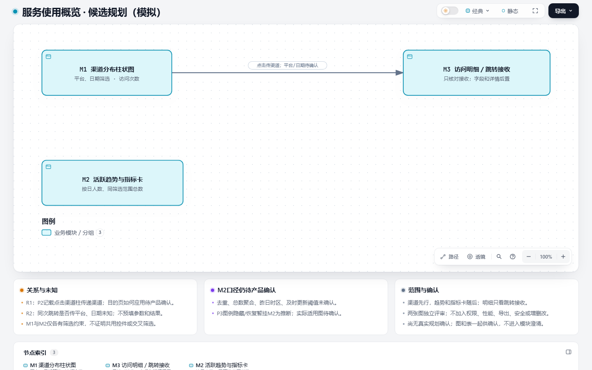
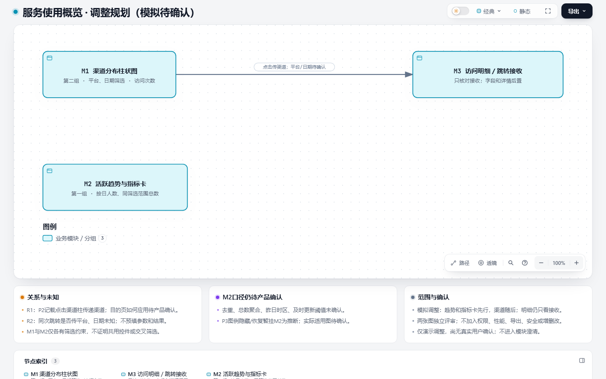

# TPD-01B 表图一起确认入口（模拟）

候选来源：开发根 evidence/tpd65-holdout/actual-output.md，是 #65 入口真实执行的模拟规划；PRD/说明见开发根 context/holdout-dashboard-prd.md、context/holdout-dashboard-user.md。未改写历史输出。

## 第一轮：原候选

| ID | 模块及本轮范围 | 梳理顺序与组织主线 | 未决 |
| --- | --- | --- | --- |
| M1 | 渠道分布柱状图；平台和日期筛选、渠道访问次数、跳转传递渠道 | 第一组，按图表→筛选/展示/跳转；与M2独立评审 | 平台/日期是否随跳转、目的页如何应用渠道待产品确认 |
| M2 | 活跃趋势及指标卡；日粒度人数、同筛选范围总数 | 第二组，按图表/指标；共同口径但各自完整审阅 | 去重、聚合、昨日时区、更新阈值、图例适用图未明 |
| M3 | 访问明细，只核对跳转接收 | 随M1核对目的端；字段/详情后置 | 不预设自动筛选或平台/日期接收规则 |

R1：点击 M1 的渠道柱 → M3，传递渠道；R2：同一方向是否同时传平台、日期待产品确认。M1/M2各有筛选不证明它们共用控件或相互联动。

[实际原图](../../.archify/architecture-planning-20261107-020000/planning.html)

请确认或调整本轮范围、组织主线和顺序。此处为模拟演示入口，没有真实用户答复；等待期间不进入模块澄清。

## 第二轮：模拟调整后的规划

演示反馈（由实现者作为模拟输入提供，不是真实用户答复）：“改为先活跃趋势与指标卡，渠道分布随后；明细仍只核对跳转接收，其他范围和未知规则不变。”

| ID | 最新顺序 | 范围与主线 |
| --- | --- | --- |
| M2 | 第一组 | 活跃趋势与指标卡先行，图表/指标主线；各自保留完整审阅内容 |
| M1 | 第二组 | 渠道分布随后，仍含筛选/展示/跳转 |
| M3 | 随M1核对 | 明细仍只看跳转接收，字段和详情后置 |

R1、R2的方向、传递内容及所有未知事项均沿用上轮；不把顺序调整解释为业务规则确认。仍排除权限、性能、导出、安全、增删改及无依据交叉筛选，不新增业务流程。

[实际调整图](../../.archify/architecture-planning-20261107-020000/adjusted.html)

请确认或继续调整这版表图。未经真实答复仍不进入模块澄清；若仅给模拟“确认这版规划”，过程记录只记“模拟确认”，下一模块安排为M2，不当作真实规划批准。

## 资料与Agent交接说明

展示版本：原候选图与调整图分别绑定独立 candidate/HTML/PNG/回执。原候选来源为 #65 冻结版本 76fb002750ad25e61cd7bd69f4e0bcc921742429 的真实入口输出；模拟调整来源为本演示，不覆盖历史用户说明。

PRD P1/P3、用户U2→M2及口径/图例缺口；P2、U3→M1/M3、R1/R2；P4→M3及后置字段/详情；P5、U3→排除/未知；U1→原顺序与独立评审，模拟调整仅改顺序。尚无真实规划确认，没有正式准确测试点MD，没有模块澄清、具体测试点评审或下游执行。
